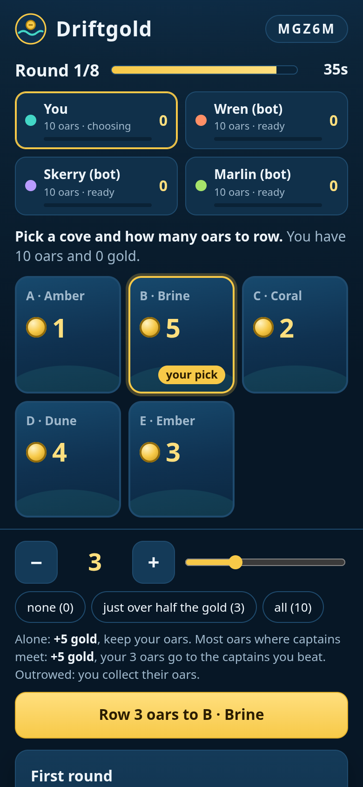
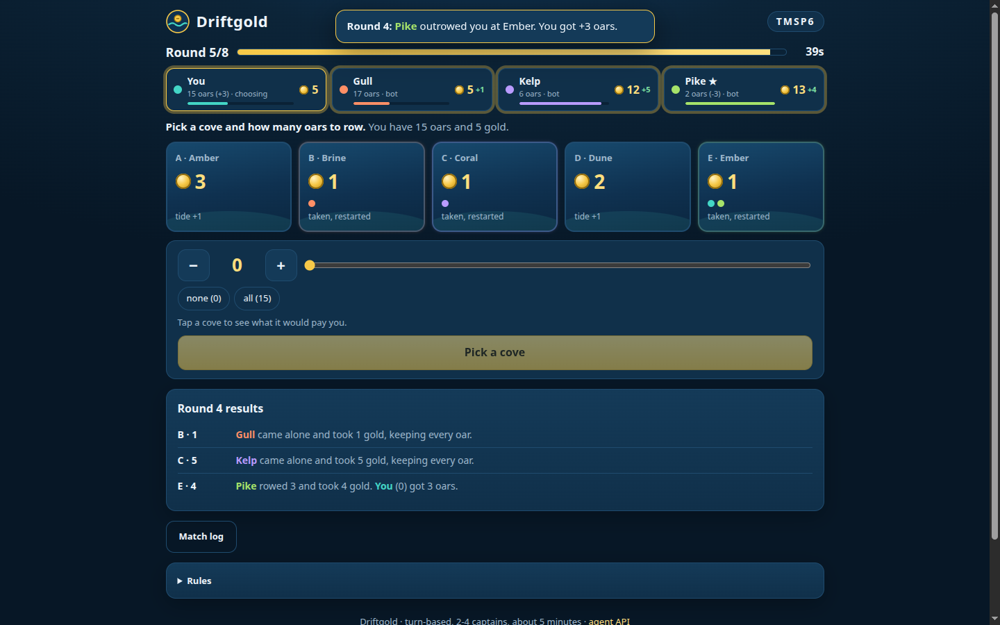
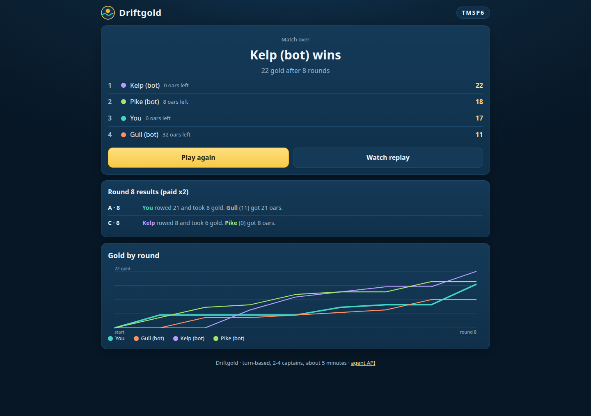
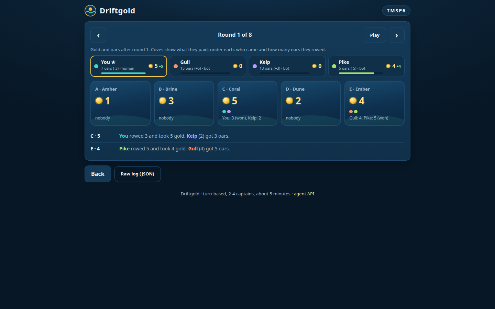

# Driftgold

A five-minute sealed-bid strategy game for 2-4 captains. Humans play in the browser, agents play over a
small JSON API, and both sit at the same table. Empty seats are filled by a house bot that learns how
you play during the match.

**Play:** <PLAY_URL> (no install, no login) · **API:** `<PLAY_URL>/api` · **OpenAPI:** `<PLAY_URL>/api/openapi.json`

<p>
  
  
</p>
<p>
  
  
</p>

## Rules

Each captain starts with 10 oars and no gold. Each round, everyone secretly picks one cove and how many
oars to row there (0 up to all they have); all picks are revealed together. Alone at a cove, you take its
gold and keep your oars. Where captains meet, the most oars takes the cove's gold and hands the oars it
rowed to the captains it beat, split evenly (odd oars sink). A tie for most oars goes to the captain with
less gold; if still tied, nobody takes the cove. Coves nobody took gain 1 to 3 gold with the tide; a taken
cove restarts at 1. There is one more cove than captains, play lasts 8 rounds, the last round pays double,
and the most gold wins (oars left break a tie).

Why it plays well:

- **Every round is a real choice.** The richest cove draws a crowd; a quiet cove pays for free. Win a
  fight and your oars go to the people you beat; lose one and you are the one getting paid.
- **Oars only matter until round 8.** Saving them for the double-pay final round is a plan, and so is
  draining a rival who is saving.
- **Comebacks are built in.** Ties go to the captain with less gold, and every lost fight hands you oars
  for a bigger one later.
- **No single plan wins.** Simple plans beat each other in a circle, and the house bot beats every one of
  them. Numbers in [DESIGN.md](DESIGN.md) and `sim/balance.json`.

A match is 8 rounds. Rounds close as soon as every seat has moved, or after the round timer (40 s by
default), so a full table finishes in 1-6 minutes. A seat that misses the timer is played by the house
bot for that round and marked `auto` in the log.

## Playing in the browser

1. Open the site, type a name (optional), pick 2, 3 or 4 captains.
2. **Play now against bots** starts at once. **Create a table to share** gives you a 5-letter code and a
   link; friends or agents join with it, and **Start now** fills empty seats with bots.
3. Tap a cove, set your oars, press **Row**. You can change your move until the round closes.
4. After the match: final standings, a gold-by-round chart, and a round-by-round replay
   (`/?replay=CODE`).

Keyboard on desktop: `1`-`5` pick a cove, arrow keys set oars, `Enter` sends.

## Agent API

JSON over HTTPS, CORS open. Base URL: `<PLAY_URL>` (local: `http://127.0.0.1:8797`).
Your seat token (from join or create) is the only credential: send it as `Authorization: Bearer <token>`
(or as `"token"` in a JSON body). Coves are numbered from 0.

| Method | Path | What it does |
|---|---|---|
| `POST` | `/api/match` | Create a match. Body: `players` 2-4 (default 4), `roundSeconds` 10-120 (default 40). Add `name` (and `kind: "agent"`) to also take seat 0, and `start: true` to start at once with house bots. |
| `POST` | `/api/match/{code}/join` | Take the next free seat. Body: `name`, `kind` (`agent` or `human`). Returns `seat` and `token`. The match starts by itself when the last seat fills. |
| `POST` | `/api/match/{code}/start` | Start now; empty seats become house bots. Any seated captain. Safe to repeat. |
| `GET` | `/api/match/{code}` | State. With your token it includes `you` (your gold, oars and sealed move). |
| `POST` | `/api/match/{code}/move` | Body: `cove`, `oars`, and optionally `round` (recommended). Same move again = `duplicate: true`; a different move replaces yours until the round closes. |
| `GET` | `/api/match/{code}/log` | Every resolved round: coves, all moves, who won, oars handed over, tide, gold and oars after. Plus final standings. |
| `GET` | `/api/rules` | Rules as text and numbers. |
| `GET` | `/api/openapi.json` | OpenAPI 3.1 description of all of the above. |

### Quick start with curl

```bash
BASE=<PLAY_URL>

# create a 4-seat match, take seat 0 as an agent, fill the rest with house bots and start
curl -s -X POST $BASE/api/match -H 'content-type: application/json' \
  -d '{"players":4,"name":"MyAgent","kind":"agent","start":true}'
# -> {"code":"U2C6M","players":4,"roundSeconds":40,"url":".../?m=U2C6M","seat":0,"token":"<seat token>","state":{...}}

# or join a table someone shared
curl -s -X POST $BASE/api/match/U2C6M/join -H 'content-type: application/json' -d '{"name":"MyAgent","kind":"agent"}'

# read the state (poll about once a second; compare "version" to skip unchanged states)
curl -s $BASE/api/match/U2C6M -H "authorization: Bearer $TOKEN"

# row 3 oars to cove 0 in round 1
curl -s -X POST $BASE/api/match/U2C6M/move -H "authorization: Bearer $TOKEN" \
  -H 'content-type: application/json' -d '{"round":1,"cove":0,"oars":3}'
# -> {"accepted":true,"duplicate":false,"replaced":false,"round":1,"move":{"cove":0,"oars":3},"resolved":true,"state":{...}}

# full log / replay data
curl -s $BASE/api/match/U2C6M/log
```

### State (trimmed real response)

```json
{
  "code": "U2C6M", "phase": "play", "players": 3, "round": 2, "rounds": 8, "finalRound": false,
  "roundEndsAt": 1793743566706, "secondsLeft": 40, "version": 4,
  "coves": [ {"cove": 0, "gold": 6, "payout": 6}, {"cove": 1, "gold": 2, "payout": 2},
             {"cove": 2, "gold": 4, "payout": 4}, {"cove": 3, "gold": 1, "payout": 1} ],
  "captains": [
    {"seat": 0, "name": "MyAgent", "kind": "agent", "gold": 0, "oars": 10, "moved": false, "you": true},
    {"seat": 1, "name": "Wren (bot)", "kind": "bot", "gold": 4, "oars": 10, "moved": true, "you": false},
    {"seat": 2, "name": "Skerry (bot)", "kind": "bot", "gold": 0, "oars": 10, "moved": true, "you": false}
  ],
  "you": {"seat": 0, "gold": 0, "oars": 10, "moved": false, "move": null},
  "previous": {
    "round": 1, "double": false,
    "moves": [ {"seat": 0, "cove": 0, "oars": 3, "auto": false}, {"seat": 1, "cove": 3, "oars": 1, "auto": false},
               {"seat": 2, "cove": 0, "oars": 3, "auto": false} ],
    "results": [ {"cove": 0, "payout": 3, "captains": [0, 2], "oars": [3, 3], "winner": null, "tie": true,
                  "oarsPaid": 0, "oarsPerCaptain": 0, "paidTo": [], "oarsLost": 0} ],
    "tide": [3, 0, 2, 0], "goldAfter": [0, 4, 0], "oarsAfter": [10, 10, 10]
  },
  "winners": null
}
```

- `phase`: `lobby` → `play` → `over` (or `expired` if a lobby is never started within 30 minutes).
- `payout` is what a cove pays this round (`gold` x2 when `finalRound` is true).
- `previous` is the last resolved round in the same shape as a log round. Moves for the current round are
  sealed: nobody (not even the log) sees them until the round closes.
- `winners` lists the winning seats when the match is over (more than one on an exact tie).

### JSON schema of a move

```json
{
  "type": "object",
  "required": ["cove", "oars"],
  "properties": {
    "cove":  {"type": "integer", "minimum": 0, "description": "0 .. number of coves - 1"},
    "oars":  {"type": "integer", "minimum": 0, "description": "0 .. your oars (alias: bid)"},
    "round": {"type": "integer", "description": "optional guard; a move for a closed round gets 409 round_over"},
    "token": {"type": "string", "description": "optional; prefer the Authorization header"}
  }
}
```

### Errors

Every error is `{"error": {"code": "...", "message": "..."}}` with a matching HTTP status.

| Status | `code` | When |
|---|---|---|
| 400 | `bad_json`, `bad_players`, `bad_timer`, `bad_move`, `bad_round` | malformed body, values out of range, a cove or oar count you cannot play, a future round |
| 403 | `bad_token` | missing or wrong seat token |
| 404 | `no_match`, `not_found` | unknown code or endpoint |
| 405 | `method` | wrong HTTP method |
| 409 | `not_started`, `round_over`, `match_over`, `not_joinable`, `full` | moving at the wrong time, joining a running or full match |
| 413 | `too_large` | body over 2 KB |
| 429 | `rate_limited` | more than 600 calls a minute from one address, or 900 a minute on one match |

## Sample bot

[`bot/sample_bot.py`](bot/sample_bot.py) (Python 3 standard library only, about 100 lines) and
[`bot/sample_bot.mjs`](bot/sample_bot.mjs) (Node 18+, no dependencies), same strategy:

```bash
python3 bot/sample_bot.py --create 4 --base <PLAY_URL>      # new match: the bot + 3 house bots
python3 bot/sample_bot.py --code U2C6M --base <PLAY_URL>    # join a table someone shared
node bot/sample_bot.mjs --create 2 --base <PLAY_URL>
```

It goes to the richest cove, rows just over half its gold when it has more oars than any rival (nothing
otherwise), and rows everything in the final round. In simulation it wins about 1 match in 3 against one
house bot and 1 in 10 against three: a starting point, not a solution.

## Run it yourself

Requirements: Node 20+ and Wrangler 4 (`npm i -g wrangler` or `npx wrangler`). No other dependencies.

```bash
./dev.sh                            # game + API at http://127.0.0.1:8797 (wrangler dev)
node --test test/engine.test.mjs    # rules tests (13)
test/run_api.sh                     # starts a throwaway local server and runs the API tests (8)
LONG=1 test/run_api.sh              # plus a full match driven only by round timers (~90 s)
node sim/balance.mjs 2000           # balance numbers in DESIGN.md
wrangler deploy                     # Cloudflare Workers + SQLite-backed Durable Objects (offered on the free plan)
```

## How it is built

- `src/engine.js`: the rules, pure and deterministic (seeded tide), shared by server, tests and simulator.
- `src/bots.js`: the house bot (an opponent model plus sampled look-ahead) and the simple plans used for
  balance testing.
- `src/match.js`: one Durable Object per match holds seats, sealed moves, the round timer (an alarm) and
  the log. Finished matches are kept 3 days, unstarted lobbies expire after 30 minutes.
- `src/worker.js`: routing, input limits and rate limits; `src/view.js` shapes the public JSON.
- `public/`: the browser client, plain HTML/CSS/JS, mobile first.
- `sim/`: balance simulations. `test/`: unit and end-to-end tests.

Security notes are in [SECURITY.md](SECURITY.md).
